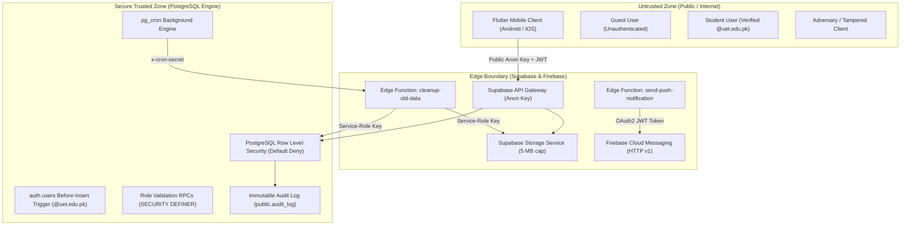

# Threat Model & Security Architecture Review
**Project**: UET Societies Hub  
**Date**: November 2026  
**Architect**: Security-Focused Senior Engineer  
**Standard**: STRIDE Methodology & Zero-Trust Serverless Model  

---

## 1. Executive Summary & Security Objectives

UET Societies Hub is a university-wide digital ecosystem providing student society directory, public feeds, executive recruitments, and private committee working groups. Because it operates exclusively under a **zero-cost serverless model** (Supabase Free Tier + Firebase FCM Free Tier + GitHub Actions), security controls cannot rely on traditional private backend application servers. 

Instead, the security architecture strictly adheres to a **Zero-Trust Client Invariant**:
> **Core Architectural Rule**: Never trust the client application for authorization, data integrity, or role assignments. Every security invariant must be enforced in the PostgreSQL database layer (Row Level Security + Triggers + Constraints) and isolated Edge Functions.

---

## 2. Trust Boundaries & Architecture Diagram

---

## 3. STRIDE Threat Analysis & Mitigations

### 3.1. Spoofing (Identity Impersonation)

| Threat ID | Threat Description | Severity | Architecture Mitigation & Proof |
| :--- | :--- | :--- | :--- |
| **S-01** | Adversary attempts to sign up with public email (e.g. `@gmail.com` or spoofed domains) to gain student access. | **Critical** | **Database Trigger Enforcement**: `trg_enforce_uet_email_domain` executes `BEFORE INSERT` on `auth.users`. Any non-`@uet.edu.pk` registration is rejected at the database transaction level with error code `P0001`, regardless of client bypasses. Verified by email OTP. |
| **S-02** | User forges JWT claims or claims `is_admin = true` in local client storage. | **Critical** | **No Client Roles**: The mobile app receives and stores only Supabase standard JWT tokens. User role elevation (President, Society Admin, System Admin) is computed dynamically within PostgreSQL using `is_society_admin(auth.uid())` and `is_system_admin(auth.uid())`. |
| **S-03** | Unauthorized caller triggers the automated data cleanup Edge Function. | **High** | **CRON_SECRET Authentication**: `cleanup-old-data` verifies the incoming `x-cron-secret` HTTP header against the `CRON_SECRET` environment variable stored in Supabase Secrets / Vault. Requests with invalid or missing secrets receive immediate `401 Unauthorized`. |

---

### 3.2. Tampering (Data Modification & Integrity)

| Threat ID | Threat Description | Severity | Architecture Mitigation & Proof |
| :--- | :--- | :--- | :--- |
| **T-01** | Student submits multiple recruitment applications for the same position to flood the selection committee. | **High** | **Composite Unique Constraint**: Table `public.applications` enforces `UNIQUE (user_id, hiring_id, position)`. PostgreSQL returns unique violation (`23505`) on any duplicate attempt. |
| **T-02** | Non-admin edits another society's announcement or event details. | **High** | **RLS Update Policies**: `posts_update_policy` requires `public.is_society_admin(society_id, auth.uid()) OR public.is_system_admin(auth.uid())`. |
| **T-03** | Removed/banned member re-joins private committee group or sends messages. | **Medium** | **Permanent Ban Check**: `public.group_banned_users` tracks barred members. `group_messages_insert_policy` contains `AND NOT EXISTS (SELECT 1 FROM group_banned_users WHERE group_id = ... AND user_id = auth.uid())`. |
| **T-04** | Client uploads malicious executable (e.g. `.exe`, `.sh`) or oversized binary into chat storage. | **High** | **Storage Bucket Limits**: Bucket `chat-attachments` enforces `file_size_limit = 5242880` (5 MB cap) and a strict whitelist of MIME types (`image/jpeg`, `image/png`, `application/pdf`, etc.). |

---

### 3.3. Repudiation (Denial of Actions)

| Threat ID | Threat Description | Severity | Architecture Mitigation & Proof |
| :--- | :--- | :--- | :--- |
| **R-01** | Admin denies deleting a post, removing a member, or approving/rejecting a society charter. | **Medium** | **Immutable Audit Log**: Every moderation RPC (`delete_reported_content`, `remove_group_member`, `resolve_report`, `suspend_society`) writes an entry to `public.audit_log` with `actor_id`, `action`, `entity_type`, `entity_id`, and metadata timestamp. RLS permits NO update or delete operations on `audit_log`. |
| **R-02** | Retention cleanup script deletes user data without traceability. | **Low** | `cleanup-old-data` logs an audit entry recording exact numbers of deleted messages, storage objects, notifications, and tokens without recording PII or content. |

---

### 3.4. Information Disclosure (Privacy & IDOR)

| Threat ID | Threat Description | Severity | Architecture Mitigation & Proof |
| :--- | :--- | :--- | :--- |
| **I-01** | Non-member accesses private committee messages or attachments by guessing group UUID (IDOR). | **Critical** | **Strict RLS Isolation**: `group_messages_select_policy` allows reading messages *only* if `public.is_group_member(group_id, auth.uid())` evaluates to true. Non-members receive 0 rows from PostgreSQL. Attachment downloads require signed URLs validated against the same check. |
| **I-02** | Student inspects competitor application answers for a hiring post. | **Critical** | **Application Privacy**: `applications_select_policy` limits access to `auth.uid() = user_id OR public.is_society_admin(hiring.society_id, auth.uid())`. Unauthorized students cannot see other submissions. |
| **I-03** | Guest or unauthenticated user reads members-only society announcements. | **High** | `posts_select_policy` enforces: if `is_public = FALSE`, the caller must be authenticated and a confirmed member of the society. |
| **I-04** | Service role key or FCM Google credentials leaked in Flutter source or APK. | **Critical** | **Zero Secrets in Mobile**: Flutter client bundles only `SUPABASE_ANON_KEY`. Service role keys and Firebase Service Account JSON credentials live exclusively in Supabase Edge Function encrypted environment variables. |

---

### 3.5. Denial of Service (Resource Exhaustion)

| Threat ID | Threat Description | Severity | Architecture Mitigation & Proof |
| :--- | :--- | :--- | :--- |
| **D-01** | Storage exhaustion on Supabase Free Tier (1 GB limit) due to chat photos and documents. | **High** | **Automated 30-Day Retention**: Edge function `cleanup-old-data` scheduled via `pg_cron` at 03:00 PKT (22:00 UTC) automatically deletes all chat attachments older than 30 days via Storage API (`chat-attachments.remove`), purging storage usage. |
| **D-02** | Client floods group chat with 100 MB video files. | **Medium** | 5 MB upload ceiling enforced by Supabase Storage server + client-side size check. Client compresses images before transmission. |
| **D-03** | Retention cleanup script times out on huge message tables. | **Medium** | Batched processing (500 items per batch) with a 50-second wall-clock circuit breaker. Dedicated indexes on `group_messages(created_at)` and `notifications(created_at)`. |

---

### 3.6. Elevation of Privilege

| Threat ID | Threat Description | Severity | Architecture Mitigation & Proof |
| :--- | :--- | :--- | :--- |
| **E-01** | Student promotes themselves to Society Admin or System Admin via direct REST update to `profiles` or `society_admins`. | **Critical** | `profiles_update_policy` permits updating only `full_name`, `avatar_url`, and `bio`. Column `is_system_admin` cannot be updated through public RLS. Table `society_admins` has insert/update restricted to Society President or System Admin. |
| **E-02** | Society Admin approves their own society registration request. | **High** | `approve_society_registration` RPC checks `public.is_system_admin(auth.uid())` and throws code `42501` (Unauthorized) for any non-system administrator. |

---

## 4. Storage Bucket Security Policy Matrix

| Bucket ID | Public Access | Max File Size | Allowed MIME Types | Read Policy | Write Policy |
| :--- | :--- | :--- | :--- | :--- | :--- |
| `society-logos` | **Public** | 5 MB | JPEG, PNG, WebP, SVG | Anyone (Public) | Society Admin / System Admin only |
| `post-media` | **Public** | 5 MB | JPEG, PNG, WebP | Anyone (Public) | Society Admin / System Admin only |
| `resumes` | **Private** | 5 MB | PDF, DOC, DOCX | Owner or Society Admin | Applicant (Owner only) |
| `chat-attachments` | **Private** | 5 MB | JPEG, PNG, WebP, PDF, DOCX, TXT | Confirmed Group Members (via Signed URL) | Confirmed Group Members only |

---

## 5. Security Verification Checklist

- [x] All 17 tables have `ENABLE ROW LEVEL SECURITY` with default deny.
- [x] PostgreSQL trigger enforces `@uet.edu.pk` domain before inserting into `auth.users`.
- [x] Storage buckets capped at 5 MB with strict MIME allowlists.
- [x] Client bundles ONLY `SUPABASE_ANON_KEY`; no service keys or private certificates in client.
- [x] `cleanup-old-data` verifies `x-cron-secret` header (rejects with 401).
- [x] `cleanup-old-data` deletes storage files via Storage API before removing DB rows (no orphans).
- [x] SQL unit test verifies unauthorized user cannot read private group rows or chat messages (`supabase/tests/rls_group_security_test.sql`).
- [x] SQL unit test verifies 31-day-old messages and files are purged while 29-day-old messages are preserved (`supabase/tests/retention_cleanup_test.sql`).
- [x] All moderation actions (content deletion, society suspension, member ban) recorded in `public.audit_log`.
- [x] Daily automated database backup configured via GitHub Actions (`pg_dump` with 30-day artifact retention).
